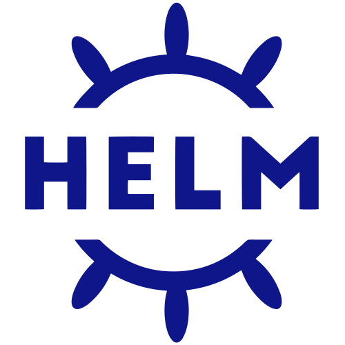

<div align="center">
  
  &nbsp;&nbsp;&nbsp;
  <picture>
    <source media="(prefers-color-scheme: dark)" srcset="docs/assets/helm-icon-white.svg">
    
  </picture>
  <h1>mitis charts</h1>
  <p><b>Describe a service, not a pile of Kubernetes manifests.</b><br>
  Small, opinionated Helm charts with a typed values interface<br>
  for running services and promoting them across environments.</p>
  <p><sub>Maintained by <a href="https://mitis.dev">mitis</a> - Kubernetes &amp; FinOps</sub></p>
  <p>
    <a href="https://github.com/mitis-cloud/charts/pkgs/container/charts%2Fservice"></a>
    <a href="https://github.com/mitis-cloud/charts/pkgs/container/charts%2Fdelivery"></a>
    <a href="https://github.com/mitis-cloud/charts/actions/workflows/ci.yaml"></a>
    <a href="https://github.com/mitis-cloud/charts/commits/main"></a>
    <a href="LICENSE"></a>
  </p>
</div>

## Why

- **One file per service.** Image, capacity, ports, health, configuration, storage, helpers and jobs live together, in plain words.
- **Typed and closed.** Unknown fields fail validation, so a typo is an error, not a silent no-op.
- **Literal by default.** The charts never run Helm `tpl` over your input, and there is no raw-manifest escape hatch to drift into.
- **Secrets declared where they're used.** Reference SSM parameters, facts or formatted strings directly; the chart generates the External Secrets plumbing.
- **Same files, any engine.** Deploy with Helmfile today; promote with Argo CD and Kargo when you're ready.

## Charts

| Chart | What it does | Package |
| --- | --- | --- |
| [**service**](charts/service/README.md) | A continuous service with its inputs, storage, helpers and jobs, or a resource-only service | `oci://ghcr.io/mitis-cloud/charts/service` |
| [**delivery**](charts/delivery/README.md) | Argo CD applications and independent Kargo promotion units across explicit environments | `oci://ghcr.io/mitis-cloud/charts/delivery` |

Both charts are public on GHCR, published from tested Git tags through CI, and pull anonymously. Each chart is versioned independently and licensed Apache-2.0.

## Quick start

A complete, deployable service:

```yaml
image:
  repository: traefik/whoami
  tag: v1.12.0
capacity:
  instances: 1
ports:
  http: 80
health:
  readiness: {http: /, port: http}
```

Render the working example from this checkout:

```sh
helm template api charts/service -f examples/service/api.yaml
```

Or pull a released chart:

```sh
helm pull oci://ghcr.io/mitis-cloud/charts/service --version 0.2.0
helm pull oci://ghcr.io/mitis-cloud/charts/delivery --version 0.1.0
```

From there, add `http` for external exposure, `environment` for configuration, and `storage`/`mounts` for files. Use named ports for internal access. Dedicated init containers, sidecars and jobs stay in the same service file. A process with an independent purpose gets its own file, even when it shares an image.

## Layering

Values flow from chart defaults, to the canonical service file, to environment defaults, to service/environment overrides. Every first-party layer uses the same vocabulary.

- Maps merge; lists replace.
- Set an environment variable, file, job, storage or mount entry to `null` to omit it.
- Files supplied through Argo CD must be plain YAML, because Argo does not evaluate Helmfile `.gotmpl` files.

**Vendor charts** are consumed directly with their own values. Anything they cannot express runs as a separate companion release of `service`. See [native vendor charts](docs/deployment.md#native-vendor-charts). The service chart has no vendor or branding namespace. The [integration guide](docs/integrations.md) documents the input-rendering helpers for products that still package their own composition.

## Guides

| Guide | Covers |
| --- | --- |
| [Service reference](charts/service/README.md) | Every field of the service chart |
| [Storage](docs/storage.md) | Shared, existing and temporary storage; ownership and retention |
| [Deployment](docs/deployment.md) | Helmfile, Argo CD, jobs and native layering |
| [Integrations](docs/integrations.md) | Infrastructure conventions and controller prerequisites |
| [Delivery reference](charts/delivery/README.md) | Argo CD and Kargo promotion |
| [Roadmap](ROADMAP.md) | What's tracked next |

## Develop and verify

Tool pins: Helm 4.3.0, kubeconform 0.8.0, Go 1.27.2 and Python 3.14, checked against current stable integration references on 2026-10-14. Go supplies native template-expansion checks and builds kubeconform. Existing consumer and controller versions are compatibility constraints; these charts don't upgrade them.

```sh
python3 -m pip install -r requirements-test.txt
make check package
pre-commit run --all-files
```

`make check` exercises:

- packaged examples and negative contracts;
- image inheritance, data ownership, engine-specific hooks, replica ownership and promotion isolation;
- input transformations through the real ESO v2 engine, at the `2.2.0` compatibility baseline pinned in `tests/eso/go.mod`;
- Kubernetes 1.35 resources, selected pinned upstream CRD schemas, and Kargo's native step-configuration schemas.

Upstream schemas download into the ignored `.cache/`. No cluster or cloud credentials are needed.

> [!NOTE]
> Render validation does not certify runtime behaviour. Readiness, traffic transitions, reloader behaviour, ApplicationSet reconciliation and live data adoption need evidence from a real environment. Examples using `example.invalid` are rendering fixtures with application-owned commands to replace before deployment; the whoami example uses a real pinned public image.

## Release

1. After required checks and review, bump only the affected chart's version.
2. Tag the tested commit `service-v<version>` or `delivery-v<version>`.
3. The tag workflow validates and packages the chart, rejects an existing version, pushes with GitHub Actions' package-scoped token, and pulls back the exact archive.

Never overwrite a released tag or package. A correction needs a new version.

GHCR creates new packages as private, even for public repositories. The package owner sets visibility to public once, then an anonymous pull verifies it. Chart pins and application image pins are independent.
